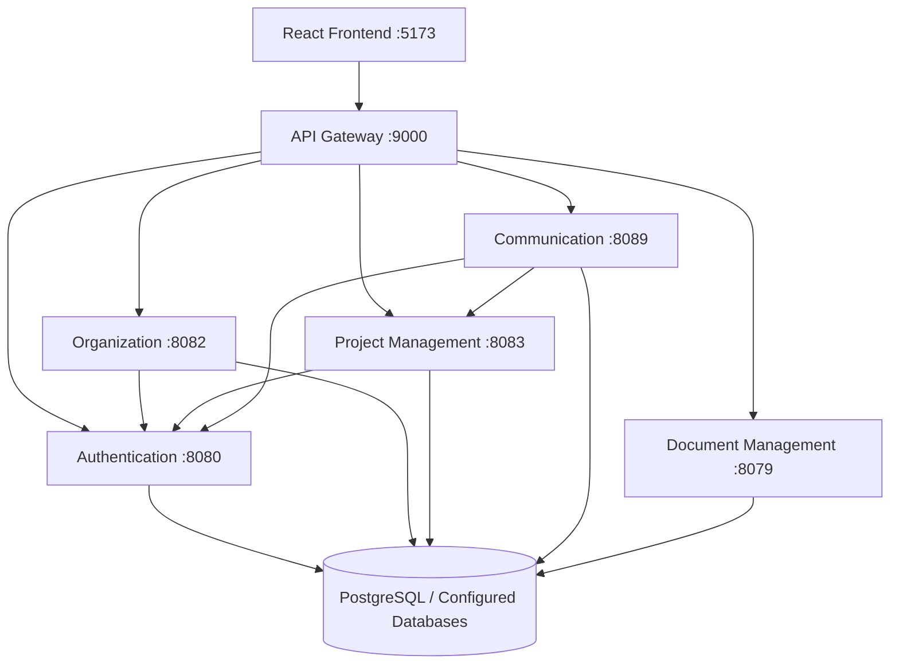
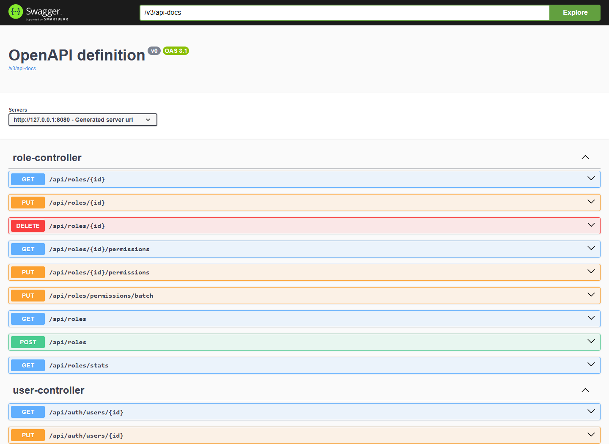
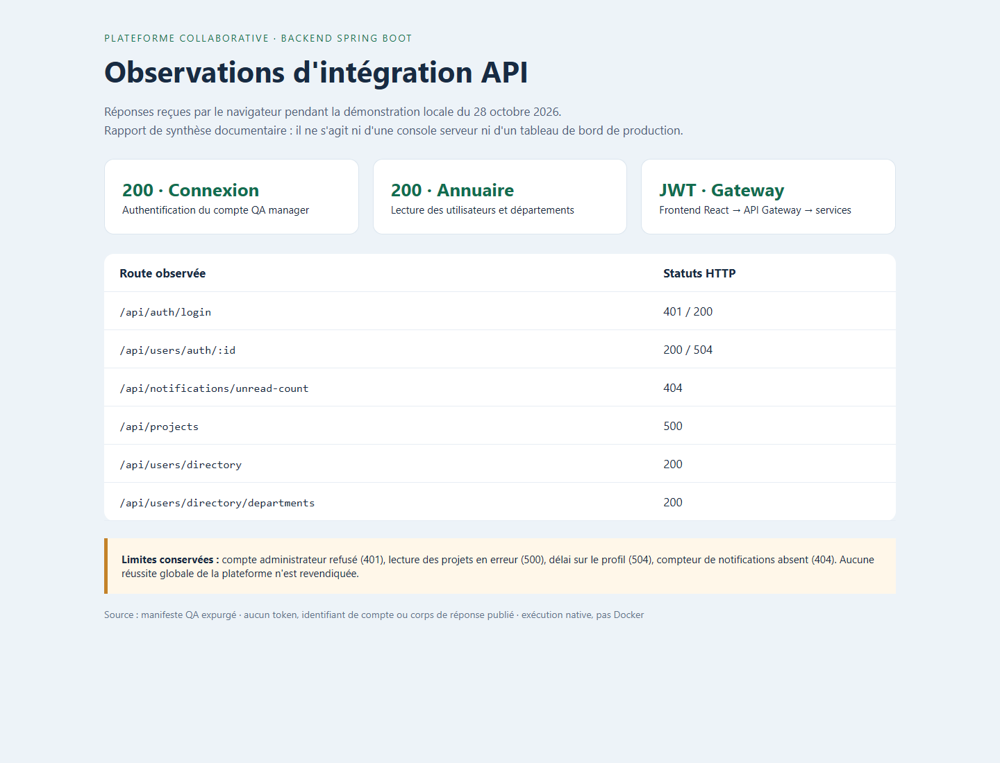

# OCP Collaborative Platform · Backend

**A Java 17 / Spring Boot backend built with a microservices architecture for identity management, organizational management, and collaborative activities.**

An API Gateway provides a unified entry point for the React frontend. The services handle JWT authentication, users and teams, projects and tasks, communication, and document management.


## Explore the Project

- [Architecture and Service Responsibilities](docs/presentation/ARCHITECTURE.md)
- [Configuration, Build, and Docker Setup](docs/presentation/RUNNING.md)
- [API Integration Screenshots and Observations](docs/presentation/DEMONSTRATION.md)
- [End-to-End Testing and QA Results](https://github.com/FATIMA-BOUSMITI/Collaborative-Platform-QA)

## The Three Repositories

| Component | Repository | Responsibility |
| --- | --- | --- |
| Frontend | [Platform-collaboration-ocp-frontend](https://github.com/FATIMA-BOUSMITI/Platform-collaboration-ocp-frontend) | React interfaces, navigation, and API integration |
| Backend | [Platform-collaboration-ocp-backend](https://github.com/FATIMA-BOUSMITI/Platform-collaboration-ocp-backend) | Spring Boot services, authentication, and data persistence |
| QA Automation | [Collaborative-Platform-QA](https://github.com/FATIMA-BOUSMITI/Collaborative-Platform-QA) | Selenium, Robot Framework, k6, and test execution evidence |

## Microservices Overview

| Service | Directory | Local Port | Responsibility |
| --- | --- | ---: | --- |
| API Gateway | `api-gatway/` | 9000 | HTTP routing, CORS, and service access |
| Authentication | `auth-service/` | 8080 | JWT authentication, token refresh, roles, permissions, and sessions |
| Organization | `User-service/` | 8082 | Users, profiles, departments, and teams |
| Project Management | `project-management-service/` | 8083 | Projects, tasks, subtasks, and scheduling |
| Communication | `communication-service/` | 8089 | Conversations, messaging, and real-time communication |
| Document Management | `document-management-service/` | 8079 | Document management |

Each microservice is an independent Maven project.

The repository root is not configured as a Maven multi-module reactor. Maven commands must therefore be executed from the corresponding service directory, or through the CI matrix.

## System Architecture



## API Documentation and Integration Overview



*Swagger documentation displayed from the locally running authentication service using actual QA authentication credentials. No data-modifying requests were executed through this interface.*



*Screenshot of a documentation report generated from HTTP responses observed during the QA demonstration. This visual is neither a server console nor a production dashboard. Identified issues have been preserved.*

The [demonstration documentation](docs/presentation/DEMONSTRATION.md) explains the supporting evidence and includes a screenshot of the frontend communicating with the backend.

A successful authentication request does not imply complete validation of the remaining microservices.

## Getting Started with Docker

### Prerequisites

- Docker Desktop or Docker Engine installed and available.
- Accessible PostgreSQL databases.
- Properly configured database schemas and credentials.

### Clone the Repository

```powershell
git clone https://github.com/FATIMA-BOUSMITI/Platform-collaboration-ocp-backend.git

cd Platform-collaboration-ocp-backend

Copy-Item .env.example .env.local
```

Configure the required private environment variables in `.env.local`.

### Build and Start the Services

```powershell
docker compose --env-file .env.local build

docker compose --env-file .env.local up -d

docker compose --env-file .env.local ps
```

Docker Compose builds **six backend images**.

However, the current configuration:

- Does not start a PostgreSQL container.
- Does not include the React frontend.
- Requires databases to be provisioned separately.

Once the backend services are running, start the frontend by following its [README](https://github.com/FATIMA-BOUSMITI/Platform-collaboration-ocp-frontend).

The schema configuration options and the `local` profile used by the organization service require reviewing the [configuration guide](docs/presentation/RUNNING.md) before deploying this Compose setup in a shared environment.

## Development and Module-Level Testing

Each microservice can be built, tested, and started independently.

Example using `auth-service/`:

```powershell
mvn test

mvn -DskipTests package

mvn spring-boot:run
```

Configure the required environment variables before starting the service.

**Important notes:**

- `mvn test` executes the module's configured tests.
- `mvn -DskipTests package` builds the application JAR without executing tests.
- `mvn spring-boot:run` starts the Spring Boot application.

Testing requirements and database dependencies vary between modules.

Tests should never be executed against a live business database.

## Continuous Integration and Docker Images

The repository contains two GitHub Actions workflows.

### Main CI Pipeline

[Main CI Workflow](.github/workflows/ci.yml)

The main pipeline includes:

- Maven test execution across six microservices.
- Maven packaging.
- Docker image builds.

### Legacy CI/CD Workflow

[Legacy CI/CD Workflow](.github/workflows/ci-cd.yml)

This workflow uses a four-service matrix and includes container registry steps.

Its trigger targets the `master` branch, while its publishing conditions check the `main` branch.

Therefore, the current configuration does not establish that Docker images are automatically published.

**CI Status Disclaimer**

This documentation describes the existing workflow configuration. It does not claim that a new Docker build or GitHub Actions execution has been successfully completed.

## Backend Testing and QA Automation

Backend tests located close to the application code remain within their respective Java microservices.

The dedicated **[QA Automation Repository](https://github.com/FATIMA-BOUSMITI/Collaborative-Platform-QA)** focuses on cross-service testing, web/API interactions, and performance testing scenarios.

### Testing Technologies

| Technology | Testing Scope |
| --- | --- |
| Selenium | Web UI automation and functional testing |
| Robot Framework | REST API testing and automated validation |
| k6 | Performance and load testing |
| GitHub Actions | Automated test execution within CI pipelines |

### Testing Strategy

The testing approach combines two complementary components:

**Backend CI**

Automates Maven testing, application packaging, and Docker image builds.

**Dedicated QA Repository**

Organizes cross-service test suites, functional scenarios, API validations, performance scripts, and execution evidence.

These components complement each other and should not be interpreted as competing implementations of the same testing scope.

The [published QA results](https://github.com/FATIMA-BOUSMITI/Collaborative-Platform-QA/blob/main/docs/results/README.md) refer to specific QA test suites and their execution dates.

They do not represent a measurement of Java test coverage within this backend repository.

## Demonstration Status

During the local demonstration session on **October 28, 2026**, the following API behaviors were observed:

| Feature | HTTP Status | Observation |
| --- | --- | --- |
| Manager Authentication | 200 | Successful authentication |
| Directory Requests | 200 | Successful responses |
| Administrator Authentication | 401 | Authentication rejected |
| Project Requests | 500 | Internal server error |
| Notification Counter | 404 | Resource not found |
| User Profile | 200 / 504 | Successful response or gateway timeout, depending on the attempt |

### Demonstration Environment

The session used previously compiled JAR files with:

- Hibernate `validate` mode.
- The existing organization service `local` profile.
- Docker Desktop unavailable during execution.

### Limitations

This demonstration does not validate:

- A complete Docker deployment.
- Production authorization rules.
- Successful integration of every microservice.
- An exact correspondence between the executed JAR files and a specific backend commit.

The results are documented to provide transparency regarding the observed behavior and known integration issues.

## Technical Documentation

| Document | Description |
| --- | --- |
| [Architecture](docs/presentation/ARCHITECTURE.md) | Microservices architecture and responsibilities |
| [Configuration and Setup](docs/presentation/RUNNING.md) | Environment configuration and startup instructions |
| [Demonstration Report](docs/presentation/DEMONSTRATION.md) | API integration evidence and observations |
| [Collaboration API Contracts](docs/COLLABORATION_API.md) | Collaborative API specifications |
| [Endpoint Inventory](docs/ERP_ENDPOINT_INVENTORY.md) | Available backend endpoints |
| [Administration Implementation](docs/ADMIN_IMPLEMENTATION.md) | Administration-related implementation details |
| [Frontend Repository](https://github.com/FATIMA-BOUSMITI/Platform-collaboration-ocp-frontend) | React frontend and interface screenshots |
| [QA Automation Repository](https://github.com/FATIMA-BOUSMITI/Collaborative-Platform-QA) | Automated testing suites and reports |

## Contributions

The Git history documents the contributions made to the application.

The project presentation, technical documentation, and QA demonstration evidence were prepared by **Fatima Bousmiti**.

Application development contributions are documented through the repository history, without attributing the entire implementation to a single contributor.
