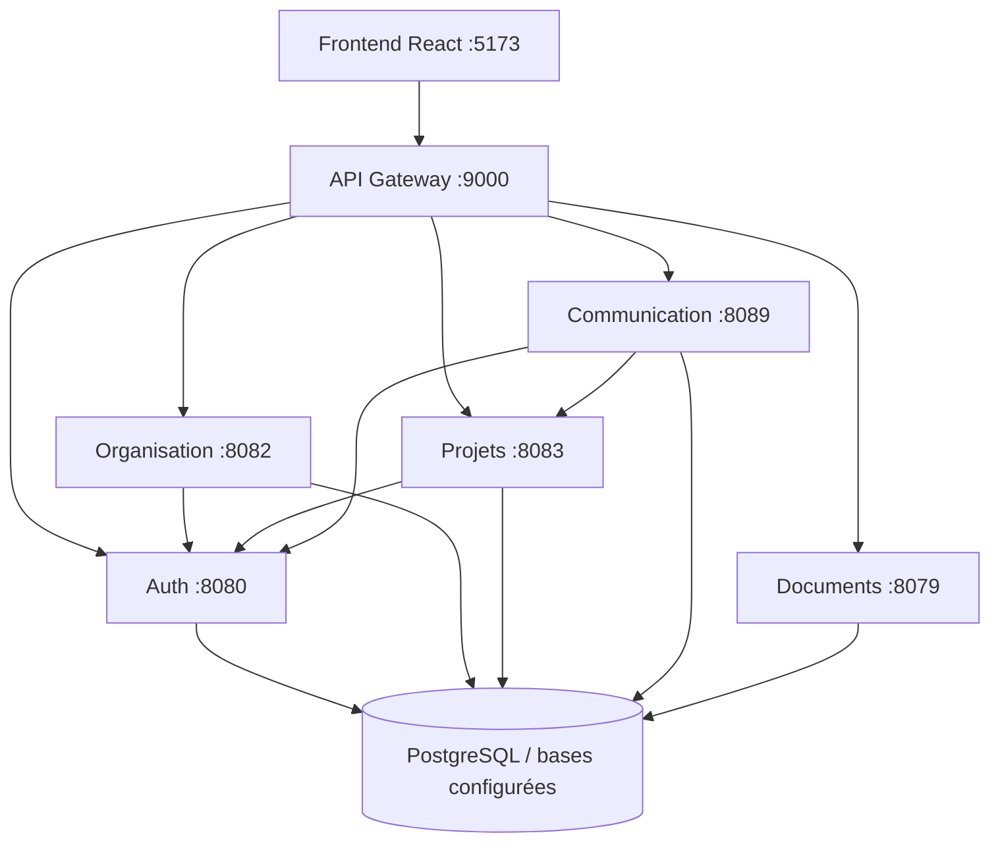

# Plateforme collaborative OCP · Backend

**Un backend Java 17 / Spring Boot organisé en microservices pour l'identité, l'organisation et les activités collaboratives.**

Une API Gateway fournit le point d'entrée commun au frontend React. Les services prennent en charge l'authentification JWT, les utilisateurs et équipes, les projets et tâches, les échanges et les documents.


## Découvrir le projet

- [Architecture et responsabilités des services](docs/presentation/ARCHITECTURE.md).
- [Configuration, build et démarrage Docker](docs/presentation/RUNNING.md).
- [Captures et observations d'intégration API](docs/presentation/DEMONSTRATION.md).
- [Tests transversaux et résultats QA](https://github.com/FATIMA-BOUSMITI/Collaborative-Platform-QA).

## Les trois dépôts

| Composant | Dépôt | Responsabilité |
| --- | --- | --- |
| Frontend | [Platform-collaboration-ocp-frontend](https://github.com/FATIMA-BOUSMITI/Platform-collaboration-ocp-frontend) | Interfaces React, navigation et appels API |
| Backend | [Platform-collaboration-ocp-backend](https://github.com/FATIMA-BOUSMITI/Platform-collaboration-ocp-backend) | Services Spring Boot, authentification et persistance |
| QA Automation | [Collaborative-Platform-QA](https://github.com/FATIMA-BOUSMITI/Collaborative-Platform-QA) | Selenium, Robot Framework, k6 et preuves d'exécution |

## Services

| Service | Répertoire | Port local | Responsabilité |
| --- | --- | ---: | --- |
| API Gateway | `api-gatway/` | 9000 | Routage HTTP, CORS et accès aux services |
| Authentification | `auth-service/` | 8080 | Connexion JWT, renouvellement, rôles, permissions et sessions |
| Organisation | `User-service/` | 8082 | Utilisateurs, profils, départements et équipes |
| Projets | `project-management-service/` | 8083 | Projets, tâches, sous-tâches et calendrier |
| Communication | `communication-service/` | 8089 | Conversations, messages et temps réel |
| Documents | `document-management-service/` | 8079 | Gestion des documents |

Les modules sont des projets Maven indépendants. La racine n'est pas un reactor Maven : lancer les commandes dans le module concerné ou utiliser la matrice CI.

## Architecture



## Documentation API et aperçu d'intégration


*Documentation Swagger affichée depuis le service local avec une authentification QA réelle. Aucun appel de modification n'a été exécuté depuis cette interface.*


*Capture d'un rapport documentaire produit à partir des réponses HTTP observées pendant la démonstration QA. Ce visuel n'est pas une console serveur ni un tableau de bord de production. Les anomalies sont conservées.*

Le [dossier de démonstration](docs/presentation/DEMONSTRATION.md) explique les preuves et inclut un écran du frontend consommant le backend. La réussite d'une connexion ne constitue pas une validation complète des autres services.

## Démarrage Docker

Prérequis : Docker Desktop/Engine disponible et bases PostgreSQL accessibles avec leurs schémas et comptes adaptés.

```powershell
git clone https://github.com/FATIMA-BOUSMITI/Platform-collaboration-ocp-backend.git
cd Platform-collaboration-ocp-backend
Copy-Item .env.example .env.local
```

Renseigner les paramètres privés de `.env.local`, puis :

```powershell
docker compose --env-file .env.local build
docker compose --env-file .env.local up -d
docker compose --env-file .env.local ps
```

Le Compose construit **six images backend**. Il ne démarre pas PostgreSQL et ne contient pas le frontend. Les bases doivent être provisionnées séparément ; lancer ensuite le frontend selon [son README](https://github.com/FATIMA-BOUSMITI/Platform-collaboration-ocp-frontend).

Les options de schéma et le profil `local` du service utilisateur nécessitent une lecture du [guide de configuration](docs/presentation/RUNNING.md) avant l'utilisation de ce Compose sur un environnement partagé.

## Développement et tests par module

Exemple depuis `auth-service/` :

```powershell
mvn test
mvn -DskipTests package
mvn spring-boot:run
```

Configurer les variables du module avant son démarrage. `-DskipTests package` produit un JAR sans valider ses tests. Les paramètres de test et besoins de base dépendent du module ; ne pas exécuter les tests contre une base métier réelle.

## CI et images

- [CI principale](.github/workflows/ci.yml) : tests et packaging Maven sur les six services, puis construction des images Docker.
- [Workflow CI-CD historique](.github/workflows/ci-cd.yml) : matrice de quatre services avec étapes de registre. Son déclenchement cible `master`, mais ses conditions de publication vérifient `main` ; ne pas en déduire que les images sont publiées automatiquement.

Cette documentation décrit la configuration présente. Elle ne revendique pas un nouveau build Docker ni une nouvelle exécution GitHub Actions réussie.

## Tests backend et dépôt QA

Les tests proches des services restent dans leurs modules Java. Le **[dépôt QA](https://github.com/FATIMA-BOUSMITI/Collaborative-Platform-QA)** couvre les interactions Web/API et les scénarios de performance.

La CI automatise l'exécution ; le dépôt QA organise les suites transversales. Les deux sont complémentaires et ne représentent pas deux versions concurrentes du même périmètre.

Les [résultats publiés](https://github.com/FATIMA-BOUSMITI/Collaborative-Platform-QA/blob/main/docs/results/README.md) concernent les suites QA identifiées et leurs dates. Ils ne constituent pas une mesure de couverture des tests Java de ce dépôt.

## État de la démonstration

Pendant la session locale du 28 octobre 2026 : connexion manager et lectures d'annuaire en 200 ; compte administrateur refusé en 401 ; projets en 500 ; compteur de notifications en 404 ; profil en 200 ou 504 selon les tentatives.

La session utilisait des JAR déjà compilés avec Hibernate `validate` et le profil utilisateur `local` existant. Docker Desktop était indisponible. Cette session ne valide ni un déploiement Docker ni les autorisations de production, et sa concordance avec un commit backend exact n'est pas établie.

## Documentation

- [Architecture](docs/presentation/ARCHITECTURE.md)
- [Configuration et démarrage](docs/presentation/RUNNING.md)
- [Démonstration commentée](docs/presentation/DEMONSTRATION.md)
- [Contrats API collaboratifs](docs/COLLABORATION_API.md)
- [Inventaire des endpoints](docs/ERP_ENDPOINT_INVENTORY.md)
- [Implémentation de l'administration](docs/ADMIN_IMPLEMENTATION.md)
- [Frontend et captures d'interface](https://github.com/FATIMA-BOUSMITI/Platform-collaboration-ocp-frontend)
- [QA et rapports](https://github.com/FATIMA-BOUSMITI/Collaborative-Platform-QA)

## Contributions

L'historique Git documente les contributions applicatives. La présentation et les preuves de démonstration QA sont préparées par **Fatima Bousmiti**, sans attribuer tout le développement applicatif à une seule personne.
